<!-- .slide: class="cover" -->

<div class="cover-card">
  <p class="cover-kicker" data-config="eyebrow">TALLER PRÁCTICO · PYTHON · INTELIGENCIA ARTIFICIAL</p>
  <h1 class="cover-title" data-config="title">Mi Primera Red Neuronal</h1>
  <p class="cover-description" data-config="subtitle">De matrices y derivadas a un clasificador de dibujos con cámara.</p>
  <div class="cover-separator"></div>
  <p class="cover-author" data-config="name">Jorge Jesús Quispe Villaverde</p>
  <p class="cover-role" data-config="role">AI Engineer · Applied AI Researcher · AI Mentor</p>
  <div class="contact-row" aria-label="Contacto del expositor">
    <a class="contact-email" data-config="email" href="mailto:jorgektch@gmail.com">jorgektch@gmail.com</a>
    <div class="contact-socials" aria-label="Redes del expositor">
      <a class="social-icon" data-social="github" href="https://github.com/jorgektch" aria-label="GitHub"><i class="fa-brands fa-github" aria-hidden="true"></i><span class="social-label">GitHub</span></a>
      <a class="social-icon" data-social="instagram" href="https://www.instagram.com/jorgektch" aria-label="Instagram"><i class="fa-brands fa-instagram" aria-hidden="true"></i><span class="social-label">Instagram</span></a>
      <a class="social-icon" data-social="tiktok" href="https://www.tiktok.com/@jorgektch" aria-label="TikTok"><i class="fa-brands fa-tiktok" aria-hidden="true"></i><span class="social-label">TikTok</span></a>
      <span class="social-handle" data-config="handle">/jorgektch</span>
    </div>
  </div>
</div>

<div class="readme-only">
<p><strong>Aprende los fundamentos y programa una red neuronal real desde cero.</strong> Este mismo README es el material del taller y se convierte en 43 diapositivas interactivas en el navegador.</p>
<p><a href="https://jorgektch.github.io/tu-primera-red-neuronal/">▶ Abrir slides</a> · <a href="https://jorgektch.github.io/tu-primera-red-neuronal/demo/">📷 Probar la app con cámara</a> · <a href="notebooks/01_mi_primera_red_neuronal.ipynb">📓 Abrir notebook</a> · <a href="data/README.md">🗃️ Dataset incluido</a> · <a href="docs/REFERENCIAS.md">📚 Papers y referencias</a></p>
<p>El dataset está <strong>dentro de este repositorio</strong>: <code>data/caritas_dataset.npz</code> (NumPy), <code>data/caritas_images.zip</code> (imágenes PNG organizadas por split y clase), <code>data/labels.csv</code> y muestras <code>data/samples/</code>. Se puede regenerar con <code>python -m src.generate_dataset</code>.</p>
<p><strong>Inicio rápido:</strong> instala Python 3.10+, ejecuta <code>pip install -r requirements.txt</code>, abre el notebook, o entrena con <code>python -m src.train</code>. El proyecto ya incluye <code>demo/model.json</code> para probar el resultado sin entrenar primero.</p>
<p><strong>Precaución:</strong> el proyecto clasifica <em>caritas dibujadas</em>, no emociones reales. El conjunto es sintético y su precisión en fotografías de papel debe medirse por separado.</p>
</div>

Note: Presentar el objetivo final y explicar que cada paso será programado con operaciones matriciales, no usando un modelo preentrenado.

---

## 02 · ¿Qué construiremos?

**Un desafío:** enseñar a una computadora a diferenciar dos dibujos.

| Entrada | Etiqueta | Ejemplo |
| :--- | :---: | :--- |
| Carita triste | `0` | Boca hacia abajo |
| Carita feliz | `1` | Sonrisa |

**Resultado:** una aplicación web que toma un dibujo con la cámara y ejecuta **nuestro propio MLP entrenado en Python**.

[Probar la aplicación](demo/) · [Explorar el notebook](notebooks/01_mi_primera_red_neuronal.ipynb).

Note: Mostrar un papel con un dibujo. No estamos haciendo reconocimiento de emociones humanas.

---

## 03 · ¿Qué aprende realmente el modelo?

Una tarea de **clasificación supervisada**:

- **X:** matriz de intensidades de los píxeles de un dibujo.
- **y:** etiqueta conocida (`0` triste, `1` feliz).
- **f(X; W,b):** función que aprende una asociación entre imagen y etiqueta.

La salida no es una evaluación psicológica ni un análisis de rostros humanos.

**Pregunta:** ¿qué ocurre si dibujo una boca recta? La red puede producir un resultado incierto o equivocarse.

Note: Distinguir clasificación de patrones de comprensión semántica de emociones.

---

## 04 · Nuestro mapa de aprendizaje

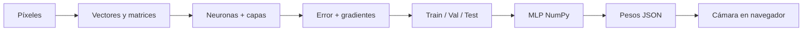

**Cada etapa se conectará con una implementación reproducible.**

*Diagrama original del taller; fundamentos en [Rumelhart et al. (1986)](https://doi.org/10.1038/323533a0).*

Note: Pedir a los participantes que reconozcan los conceptos familiares y cuáles son nuevos.

---

## 05 · ¿De dónde vienen las redes neuronales?

| Año | Trabajo científico | Idea clave |
| :--- | :--- | :--- |
| 1943 | McCulloch & Pitts | Modelos lógicos de unidades neuronales |
| 1958 | Rosenblatt | Perceptrón para aprendizaje de patrones |
| 1986 | Rumelhart, Hinton & Williams | Aprendizaje por retropropagación |
| 1998 | LeCun et al. | Redes entrenadas con gradientes para visión |

Fuentes: [1943](https://doi.org/10.1007/BF02478259) · [1958](https://doi.org/10.1037/h0042519) · [1986](https://doi.org/10.1038/323533a0) · [1998](https://doi.org/10.1109/5.726791).

*Cronología explicativa; no implica que estas técnicas surgieran exclusivamente en esos años.*

Note: Aclarar que son hitos y que existen múltiples contribuciones históricas.

---

## 06 · Una imagen también es una matriz

Una imagen en **escala de grises** se representa mediante una tabla de números.

```text
  0    0   32   80
  0   24  180  250
 15  100  255  220
  0   35  120   10
```

En el proyecto cada dibujo se transforma a **28 × 28 = 784 píxeles**.

¿Dónde están los ojos? ¿Y la boca? La red no recibe esos nombres: recibe números.

Note: El ejemplo 4x4 es ilustrativo, no un recorte del dataset real.

---

## 07 · De un trazo a un número

Nuestro contrato de entrada:

- Hoja blanca y **trazo oscuro**.
- Escala de grises, estimación del fondo y conversión a intensidad de tinta.
- Valores entre `0` (fondo) y `1` (trazo oscuro).
- Cuadro de tinta centrado y redimensionado a **28×28**.

```python
from src.preprocess import preprocess_image
x = preprocess_image(imagen_pillow)
assert x.shape == (784,)
```

La cámara y Python aplicarán el mismo **contrato de preprocesamiento**.

Note: Un preprocesamiento inconsistente es una causa común de mal desempeño en despliegue.

---

## 08 · De matriz a vector

```python
import numpy as np
imagen = np.arange(28*28).reshape(28,28)
vector = imagen.reshape(784)
print(imagen.shape, vector.shape)
# (28, 28) (784,)
```

**Flatten** conserva los valores, pero reorganiza su estructura.

En nuestro MLP una imagen pasa a ser una fila `X = [x₁, x₂, …, x₇₈₄]`.

**Reto:** ¿cuántos valores habría en una imagen RGB de 28×28?

Note: Respuesta: 2352 valores si se usan tres canales RGB sin comprimir.

---

## 09 · Dimensiones de las matrices

| Operación | Dimensión de entrada | Resultado |
| :--- | :--- | :--- |
| `X @ W1` | `(B,784) @ (784,32)` | `(B,32)` |
| `A1 @ W2` | `(B,32) @ (32,16)` | `(B,16)` |
| `A2 @ W3` | `(B,16) @ (16,1)` | `(B,1)` |

`B` es el número de ejemplos del batch. Multiplicar matrices exige que coincidan las dimensiones interiores.

**Regla:** `(a,b) @ (b,c) -> (a,c)`.

Note: Demostrar con una matriz 2x3 y otra 3x2 en una pizarra.

---

## 10 · Producto punto: la operación esencial

Para tres entradas:

`z = x₁·w₁ + x₂·w₂ + x₃·w₃ + b`

Supongamos `x=[0.2,0.8,0.5]`, `w=[0.4,-0.3,0.9]`, `b=0.1`.

`z = 0.08 - 0.24 + 0.45 + 0.1 = 0.39`

**Pesos** modulan cuánto influye cada entrada; **bias** desplaza la salida.

*Idea del perceptrón: [Rosenblatt (1958)](https://doi.org/10.1037/h0042519).*

Note: Resolver primero a mano. Los pesos no son una explicación causal automática.

---

## 11 · Primera práctica con NumPy

```python
import numpy as np
x = np.array([0.2, 0.8, 0.5])
w = np.array([0.4, -0.3, 0.9])
b = 0.1
z = x @ w + b
print(z)  # 0.39
```

**Ejercicios:**

1. Cambia `w[1]` y observa el resultado.
2. ¿Qué ocurre si el bias pasa de `0.1` a `-0.1`?
3. Explica por qué `x` y `w` tienen el mismo tamaño.

Note: Ejecutar esta celda frente a la audiencia antes de hablar de capas.

---

## 12 · Una neurona artificial

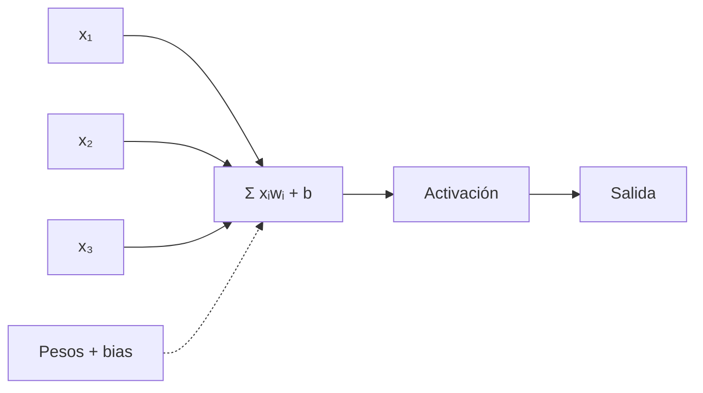

La neurona calcula una transformación de números. Una red combina muchas de estas operaciones.

*Diagrama original; inspiración conceptual en [Rosenblatt (1958)](https://doi.org/10.1037/h0042519).*

Note: Explicar que la neurona artificial es una simplificación extrema, no una réplica biológica.

---

## 13 · ¿Por qué una activación?

Sin una transformación no lineal, varias capas lineales consecutivas se pueden expresar como **una única transformación lineal**.

Con una no linealidad, una red puede modelar fronteras de decisión más complejas.

**Esquema:** multiplicación matricial → activación → siguiente capa.

*Exploración de activaciones e inicialización: [Glorot & Bengio (2010)](https://proceedings.mlr.press/v9/glorot10a.html).*

Note: No atribuir ReLU a Glorot; usar el paper como referencia del efecto de activaciones en el entrenamiento.

---

## 14 · ReLU y sigmoide

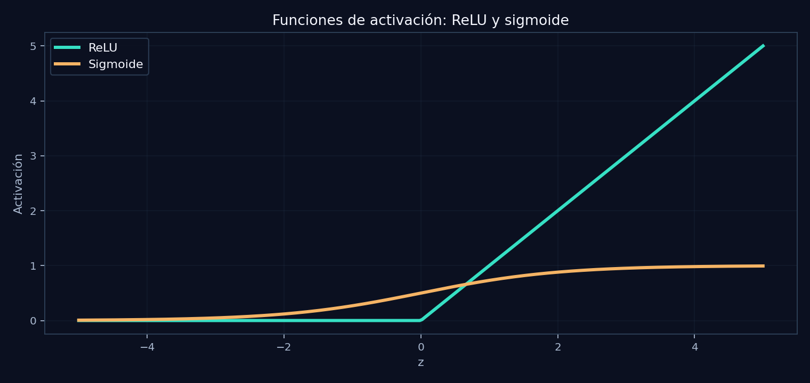

- **ReLU(z) = max(0,z):** activaciones ocultas.
- **Sigmoide(z) = 1/(1+e^-z):** salida binaria en `[0,1]`.

*Figura original generada con `src/plot_results.py`.*

Note: Mostrar que ReLU es cero para z negativo. La salida sigmoide es un score no calibrado.

---

## 15 · Cuando una neurona no basta

El problema **XOR** no puede resolverse con una frontera lineal única:

| x₁ | x₂ | XOR |
| :---: | :---: | :---: |
| 0 | 0 | 0 |
| 0 | 1 | 1 |
| 1 | 0 | 1 |
| 1 | 1 | 0 |

Las **capas ocultas con activaciones no lineales** pueden representar combinaciones de patrones.

**Pregunta:** ¿qué rasgos podrían combinarse para distinguir una sonrisa de una boca invertida?

Note: XOR es una motivación matemática, no el objetivo directo del dataset.

---

## 16 · Nuestra arquitectura MLP

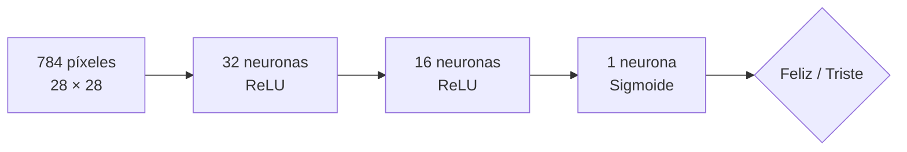

Las matrices y los bias son **parámetros aprendidos**. No usamos TensorFlow, PyTorch ni una API de clasificación.

*Diagrama original; entrenamiento de representaciones ocultas: [Rumelhart et al. (1986)](https://doi.org/10.1038/323533a0).*

Note: Usar flecha abajo para la diapositiva de dimensiones (detalle vertical).

--

## 17 · Detalle vertical: formas de cada tensor

| Tensor | Forma | Papel |
| :--- | :--- | :--- |
| `X` | `B × 784` | Batch de imágenes |
| `W1`, `b1` | `784 × 32`, `1 × 32` | Primera capa |
| `W2`, `b2` | `32 × 16`, `1 × 16` | Segunda capa |
| `W3`, `b3` | `16 × 1`, `1 × 1` | Salida |

**Recuerda:** `Z = A @ W + b`. NumPy aplica *broadcasting* al bias.

Prueba: `np.zeros((8,784)) @ np.zeros((784,32))`.

Note: Preguntar por qué (1,32) se suma correctamente a (8,32).

---

## 18 · Forward propagation

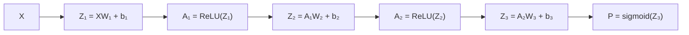

Los participantes implementarán **cada operación** con matrices NumPy.

*Esquema original a partir del cálculo de redes multicapa descrito por [Rumelhart et al. (1986)](https://doi.org/10.1038/323533a0).*

Note: Hacer que lean las dimensiones en cada flecha.

---

## 19 · Binary Cross-Entropy (BCE)

Para una etiqueta `y ∈ {0,1}` y predicción `p`:

`L = -mean[y·log(p) + (1-y)·log(1-p)]`

La pérdida crece cuando la red se muestra segura y se equivoca.

En código usamos una forma **estable numéricamente** basada en `z` (logit):

```python
loss = np.mean(np.logaddexp(0, z) - y*z)
```

**Objetivo del entrenamiento:** minimizar esta pérdida.

Note: Un loss de cero sería predicción perfecta con certeza extrema; no garantiza generalización.

---

## 20 · ¿Qué significa aprender?

Al comenzar, los pesos son números aleatorios inicializados a escala apropiada.

Durante el entrenamiento:

1. Hacemos una predicción.
2. Calculamos el error respecto a la etiqueta.
3. Calculamos cómo cambiar los parámetros.
4. Actualizamos matrices y bias.
5. Repetimos con nuevos batches.

**Aprender no significa memorizar literalmente cada imagen.**

Note: Discutir memorizar vs generalizar; mencionar métricas en ejemplos no vistos.

---

## 21 · Descenso del gradiente

La actualización general de un parámetro `θ` es:

`θ_nuevo = θ_actual - η · ∂L/∂θ`

- `η` (eta): *learning rate* o tamaño del paso.
- `∂L/∂θ`: dirección local de cambio de la pérdida.

Un paso muy grande puede desestabilizar el aprendizaje; uno pequeño puede hacerlo lento.

**Pregunta:** ¿cómo elegiríamos el learning rate? Con validación, no con el conjunto de test.

Note: Dibujar una curva de pérdida como paisaje; las ecuaciones sirven para modificar W y b.

---

## 22 · La regla de la cadena

Si `z = w·x + b`, `a = sigmoid(z)` y `L = loss(a,y)`:

`∂L/∂w = (∂L/∂a)·(∂a/∂z)·(∂z/∂w)`

La derivada de una operación compuesta se obtiene multiplicando las contribuciones de cada etapa.

**Por qué importa:** permite que el error de salida influya sobre pesos de capas anteriores.

*Desarrollo de retropropagación: [Rumelhart et al. (1986)](https://doi.org/10.1038/323533a0).*

Note: Resolver ejemplo simple y preguntar qué depende de qué.

---

## 23 · Backpropagation: viajar hacia atrás

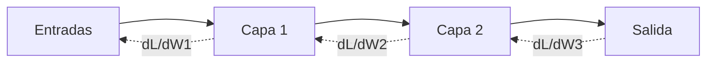

Para sigmoide + BCE: `dZ₃ = (P - y) / B`.

Para cada capa: `dW = A_anterior.T @ dZ` y `db = suma(dZ)`.

*Diagrama original basado en [Rumelhart et al. (1986)](https://doi.org/10.1038/323533a0).*

Note: La flecha punteada representa gradientes; no datos que viajen al revés en inferencia.

---

## 24 · Epochs, batches y learning rate

| Concepto | Significado | En este taller |
| :--- | :--- | :--- |
| Epoch | Recorrer todo el train | 45 |
| Batch | Subconjunto de ejemplos | 64 |
| Learning rate | Tamaño de actualización | 0.25 |
| Semilla | Repetibilidad | 42 |

Los valores son **hiperparámetros de ejemplo**, no óptimos universales.

¿Puedes distinguir un parámetro aprendido (`W`) de un hiperparámetro (`learning rate`)?

Note: Abrir la subdiapositiva sobre gradient checking con abajo.

--

## 25 · Validar gradientes con diferencias finitas

Antes de confiar en nuestra retropropagación:

`grad_num ≈ [L(θ + ε) - L(θ - ε)] / (2ε)`

Comparamos este valor con el gradiente derivado analíticamente.

```python
from src.neural_network import MLP, gradient_check
modelo = MLP((4,5,3,1), dtype=float)
# Usa un batch pequeño y verifica los gradientes.
```

*Ver `test_gradient_check` en `tests/test_workshop.py`.*

Note: No usar float32 para una diferencia muy pequeña; float64 mejora la estabilidad numérica.

---

## 26 · ¿Qué contiene nuestro dataset?

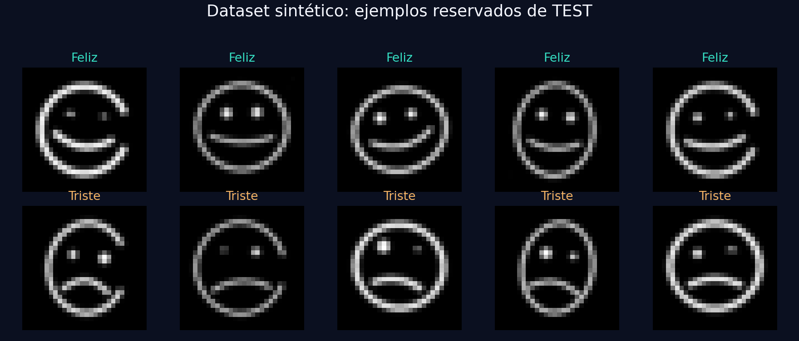

**Carita triste = 0 · Carita feliz = 1**.

Incluido en el repositorio como `data/caritas_dataset.npz` y `data/caritas_images.zip`.

*Imagen generada con `src/plot_results.py` a partir del test incluido.*

Note: Aclarar que real significa procedente del dataset ejecutado, no fotos reales de papel.

---

## 27 · Generar datos con Python y Pillow

El generador dibuja **contornos, ojos y curvas de boca** y altera atributos dentro de rangos.

```bash
python -m src.generate_dataset --seed 2026
```

El archivo `data/caritas_images.zip` contiene imágenes PNG organizadas por carpeta y etiqueta.

**No descargamos datasets externos ni usamos rostros reales.**

Código: [`src/generate_dataset.py`](src/generate_dataset.py).

Note: Mostrar muestra de imágenes originales del ZIP, no solo de las normalizadas.

---

## 28 · Data augmentation

Variaciones de los dibujos sintéticos:

- Contorno ligeramente elíptico, posición y tamaño.
- Rotación moderada, grosor de trazo y ojos.
- Ruido y cambios suaves de iluminación.
- Curvatura de la boca: la diferencia principal entre clases.

**Precaución:** el aumento de datos solo sirve si respeta la etiqueta real.

En este proyecto se generan muestras independientes para cada partición.

Note: Evitar rotaciones grandes que cambien la semántica de la boca.

---

## 29 · Train, Validation y Test

| Split | Por clase | Total | Uso |
| :--- | ---: | ---: | :--- |
| Train | 900 | **1800** | Actualizar pesos |
| Validation | 160 | **320** | Elegir hiperparámetros |
| Test | 160 | **320** | Evaluación final |

Las imágenes se generan con semillas reproducibles y **no se duplican** entre los splits.

**Regla:** nunca entrenes ni ajustes con el conjunto de test.

Note: Si el usuario incorpora varios aumentos de una foto, separarlos por foto fuente antes de aumentar.

---

## 30 · Un único contrato de preprocesamiento

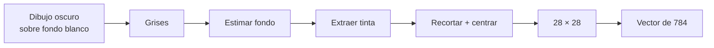

El navegador replica la lógica de `src/preprocess.py` en `demo/preprocess.mjs`.

*Pipeline original del proyecto: documentado en `docs/DATASET.md`.*

Note: Mostrar por qué una imagen sin tinta devuelve vector cero.

---

## 31 · ¿Generalizará a dibujos reales?

El dataset es **sintético**: hay un riesgo real de cambio de dominio al fotografiar papel.

**Prueba rigurosa:**

1. Dibuja caritas nuevas con varios marcadores.
2. Cambia la iluminación y la distancia.
3. Registra aciertos, errores y casos inciertos.
4. Separa un pequeño **test real independiente**.

El resultado en ese test real podría ser muy inferior al test sintético: **no prometemos una precisión específica**.

Note: Distinguir precisión sintética de generalización. No reportar test sintético como de producción.

---

## 32 · Preparar el entorno

```bash
python -m venv .venv
# Windows: .venv\Scripts\activate
# Linux/macOS: source .venv/bin/activate
pip install -r requirements.txt
jupyter notebook
```

Con la carpeta raíz como directorio de trabajo, abre:

[`notebooks/01_mi_primera_red_neuronal.ipynb`](notebooks/01_mi_primera_red_neuronal.ipynb).

**Necesitas:** Python 3.10+ y NumPy, Pillow y Matplotlib.

Note: Mostrar la diferencia entre ejecutar en raíz e importar src desde subcarpeta.

---

## 33 · Cargar X e y del dataset incluido

```python
from src.preprocess import load_datasets
d = load_datasets('data/caritas_dataset.npz')
X_train, y_train = d['X_train'], d['y_train']
X_val, y_val = d['X_val'], d['y_val']
X_test, y_test = d['X_test'], d['y_test']
print(X_train.shape, y_train.shape)
# (1800, 784) (1800, 1)
```

Todos los ejemplos están dentro del repositorio: **no hace falta descargarlos**.

Note: Pedir a los participantes que impriman los valores mínimo, máximo y media de X_train.

---

## 34 · Inicializar pesos con formas correctas

```python
import numpy as np
rng = np.random.default_rng(42)
W1 = rng.normal(0, np.sqrt(2/784), (784,32))
b1 = np.zeros((1,32))
W2 = rng.normal(0, np.sqrt(2/32), (32,16))
b2 = np.zeros((1,16))
W3 = rng.normal(0, np.sqrt(1/16), (16,1))
b3 = np.zeros((1,1))
```

Inicialización escalada para ReLU: [He et al. (2015)](https://openaccess.thecvf.com/content_iccv_2015/html/He_Delving_Deep_into_ICCV_2015_paper.html). Contexto: [Glorot & Bengio (2010)](https://proceedings.mlr.press/v9/glorot10a.html).

Note: Aclarar que la implementación usa una variante He para las capas ReLU; la cita de Glorot cubre el problema general de escalado.

---

## 35 · Codificar nuestro forward pass

```python
Z1 = X @ W1 + b1
A1 = np.maximum(Z1, 0)
Z2 = A1 @ W2 + b2
A2 = np.maximum(Z2, 0)
Z3 = A2 @ W3 + b3
P  = 1 / (1 + np.exp(-np.clip(Z3,-40,40)))
```

`X` contiene un batch de imágenes. `P` tiene tamaño `(B,1)`.

Implementación reutilizable: [`src/neural_network.py`](src/neural_network.py).

Note: Recorrer línea a línea y repetir dimensiones de cada tensor.

---

## 36 · Codificar el backward pass

```python
B = len(X)
dZ3 = (P - y) / B
dW3 = A2.T @ dZ3
dZ2 = (dZ3 @ W3.T) * (Z2 > 0)
dW2 = A1.T @ dZ2
dZ1 = (dZ2 @ W2.T) * (Z1 > 0)
dW1 = X.T @ dZ1
```

También calculamos `db` como suma por columnas y actualizamos `W -= lr*dW`.

*Fundamento: [Rumelhart et al. (1986)](https://doi.org/10.1038/323533a0).*

Note: Se omiten db en el extracto visual: están implementados en notebook y src.

---

## 37 · Entrenar con datos del repositorio

```bash
python -m src.train --epochs 45 --lr 0.25
python -m src.evaluate
```

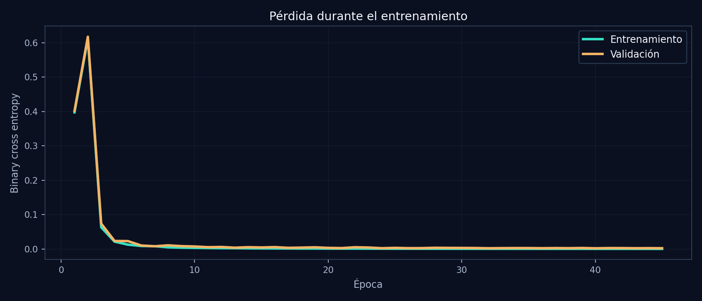

**Train** actualiza parámetros; **Validation** selecciona pesos; **Test** queda reservado hasta el final.

Note: Las curvas mostradas se generaron con models/history.json, no son gráficos ilustrativos.

---

## 38 · ¿Qué resultados obtuvimos?

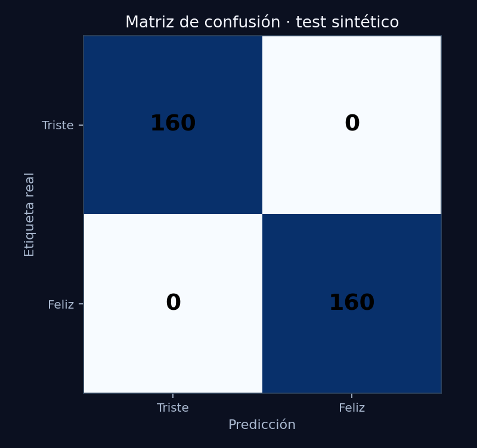

**320 imágenes sintéticas de test · 320 aciertos (100 %)** en la ejecución empaquetada.

Es un resultado medido en dibujos generados por nuestro programa, **NO una validación en fotografías reales**.

Archivo reproducible: [`models/test_report.json`](models/test_report.json).

Note: Evitar que 100% se interprete como objetivo o garantía de un sistema general.

---

## 39 · Guardar y exportar lo aprendido

```bash
python -m src.train
python -m src.export_model
```

- `models/weights.npz`: matrices NumPy entrenadas.
- `demo/model.json`: **los mismos pesos**, compatibles con el navegador.
- `models/metrics.json`: hiperparámetros y métricas medidas.

**No exportamos una etiqueta fija ni respuestas simuladas.** La app ejecuta las multiplicaciones reales.

Note: Reentrenar modifica los pesos exportables. El model.json incluido corresponde a la ejecución empaquetada.

---

## 40 · Arquitectura de nuestra app con cámara

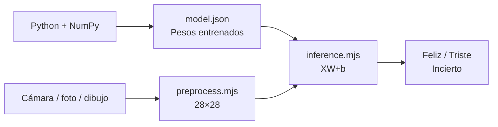

**Sin servidor de inferencia:** GitHub Pages entrega los archivos; JavaScript predice localmente.

Código: [`demo/inference.mjs`](demo/inference.mjs).

Note: La app no transmite imágenes a servicios de terceros; examinar el código para confirmarlo.

---

## 41 · Cámara: permiso y captura

La aplicación solicita permiso con `navigator.mediaDevices.getUserMedia()`.

- **HTTPS o localhost**, permiso explícito.
- Recuadro guía para centrar el dibujo.
- Opciones alternativas: **subir una imagen** o **dibujar en pantalla**.
- Captura de la imagen → recorte cuadrado → normalización.

[Abrir demostración con cámara](demo/)

*API web: [MDN getUserMedia](https://developer.mozilla.org/en-US/docs/Web/API/MediaDevices/getUserMedia).*

Note: En móvil pedir cámara tras un clic. Mostrar cómo denegar permiso no bloquea subir imágenes.

---

## 42 · Inferencia: Python y navegador concuerdan

```javascript
// demo/inference.mjs
for (let j=0; j<layer.output; j++) {
  let z = layer.bias[j];
  for (let i=0; i<layer.input; i++) {
    z += x[i] * layer.weights[i*layer.output+j];
  }
  next[j] = activation(z);
}
```

La prueba `tests/browser_model.test.mjs` compara predicciones del modelo exportado con Python sobre ejemplos de test.

**¿Cómo medimos la diferencia entre ambas implementaciones?**

Note: Explicar orden row-major y que la arquitectura de capas debe corresponder con el JSON exportado.

---

<!-- .slide: class="closing" -->
<div class="closing-card">
  <h1>¡Lo lograste! 🧠</h1>
  <p>De una matriz de píxeles a tu primera red neuronal entrenada y aplicada con cámara.</p>
  <p class="closing-question">¿Qué mejorarías para reconocer dibujos reales?</p>
  <p><a href="demo/">Probar la app</a> · <a href="docs/REFERENCIAS.md">Papers y bibliografía</a> · <a href="notebooks/01_mi_primera_red_neuronal.ipynb">Notebook completo</a></p>
  <div class="contact-row" aria-label="Contacto del expositor">
    <a class="contact-email" data-config="email" href="mailto:jorgektch@gmail.com">jorgektch@gmail.com</a>
    <div class="contact-socials">
      <a class="social-icon" data-social="github" href="https://github.com/jorgektch" aria-label="GitHub"><i class="fa-brands fa-github" aria-hidden="true"></i><span class="social-label">GitHub</span></a>
      <a class="social-icon" data-social="instagram" href="https://www.instagram.com/jorgektch" aria-label="Instagram"><i class="fa-brands fa-instagram" aria-hidden="true"></i><span class="social-label">Instagram</span></a>
      <a class="social-icon" data-social="tiktok" href="https://www.tiktok.com/@jorgektch" aria-label="TikTok"><i class="fa-brands fa-tiktok" aria-hidden="true"></i><span class="social-label">TikTok</span></a>
      <span class="social-handle" data-config="handle">/jorgektch</span>
    </div>
  </div>
</div>
Note: Cerrar recordando que el 100% sintético no valida el uso real. Invitar a probar nuevos dibujos y revisar las fuentes.

