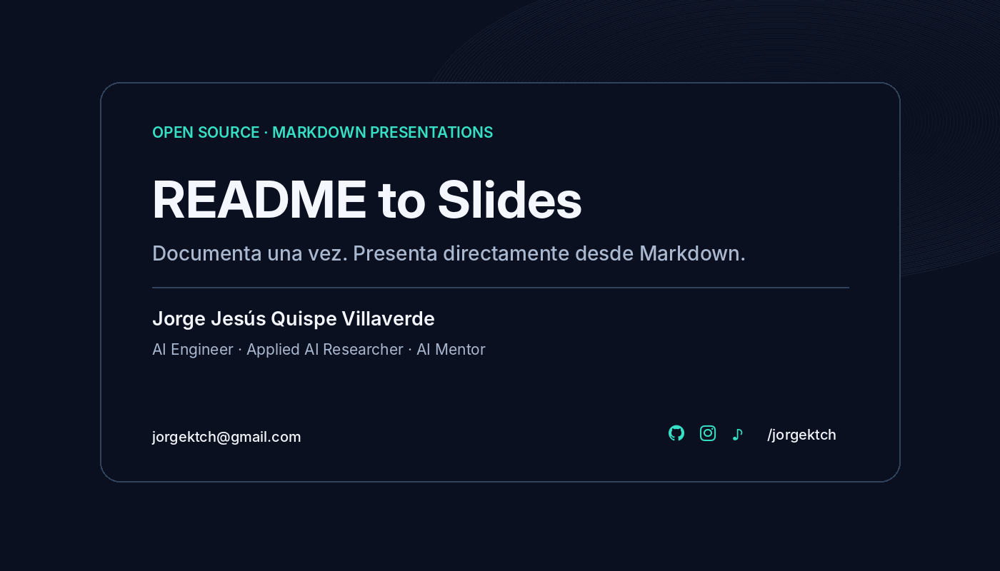
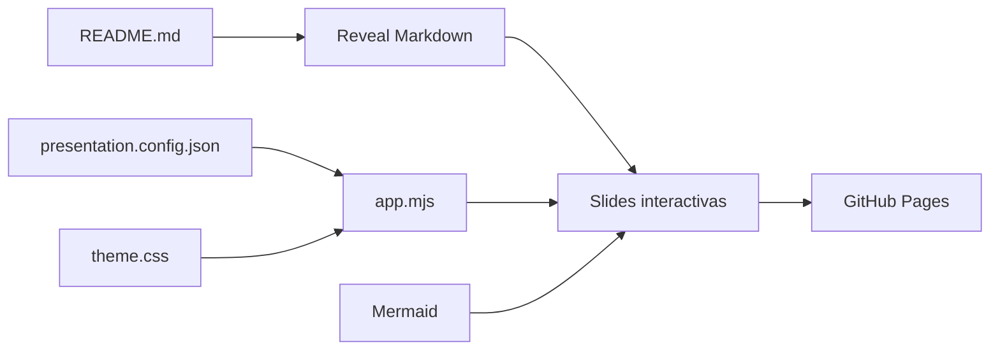
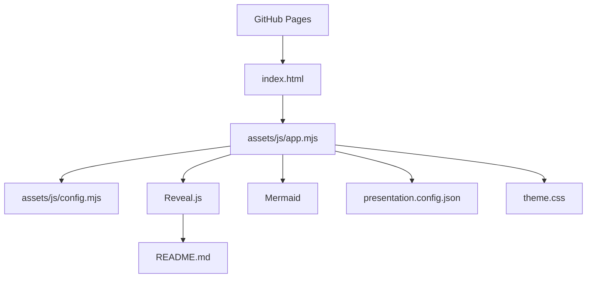
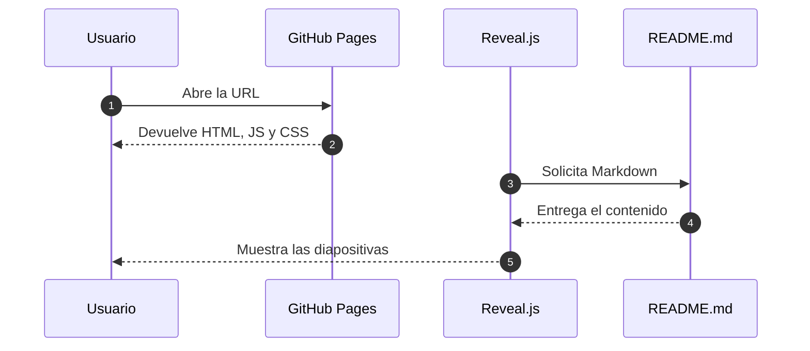
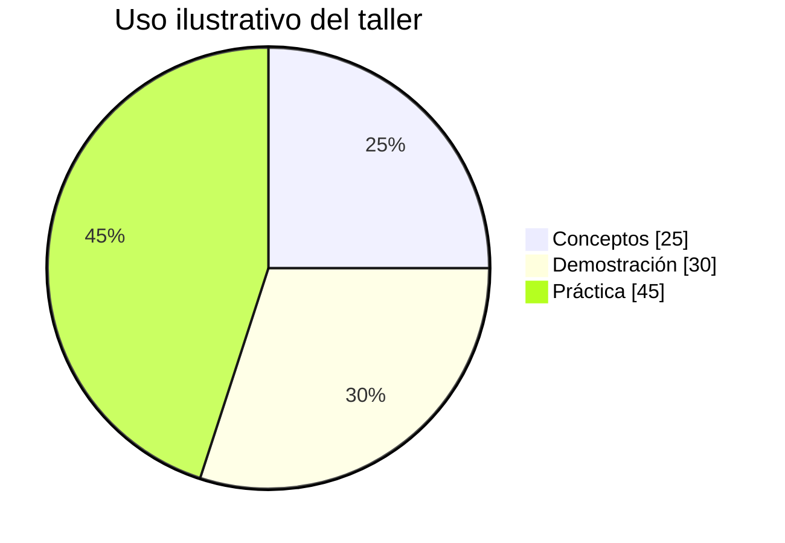

<!-- .slide: class="cover" -->

<div class="cover-card">
  <p class="cover-kicker" data-config="eyebrow">OPEN SOURCE · MARKDOWN PRESENTATIONS</p>
  <h1 class="cover-title" data-config="title">README to Slides</h1>
  <p class="cover-description" data-config="subtitle">Documenta una vez. Explica, demuestra y presenta directamente desde Markdown.</p>
  <div class="cover-separator"></div>
  <p class="cover-author" data-config="name">Jorge Jesús Quispe Villaverde</p>
  <p class="cover-role" data-config="role">AI Engineer · Applied AI Researcher · AI Mentor</p>
  <div class="contact-row" aria-label="Contacto del expositor">
    <a class="contact-email" data-config="email" href="mailto:jorgektch@gmail.com">jorgektch@gmail.com</a>
    <div class="contact-socials" aria-label="Redes del expositor">
      <a class="social-icon" data-social="github" href="https://github.com/jorgektch" aria-label="GitHub" title="GitHub"><i class="fa-brands fa-github" aria-hidden="true"></i><span class="social-label">GitHub</span></a>
      <a class="social-icon" data-social="instagram" href="https://www.instagram.com/jorgektch" aria-label="Instagram" title="Instagram"><i class="fa-brands fa-instagram" aria-hidden="true"></i><span class="social-label">Instagram</span></a>
      <a class="social-icon" data-social="tiktok" href="https://www.tiktok.com/@jorgektch" aria-label="TikTok" title="TikTok"><i class="fa-brands fa-tiktok" aria-hidden="true"></i><span class="social-label">TikTok</span></a>
      <span class="social-handle" data-config="handle">/jorgektch</span>
    </div>
  </div>
</div>

<div class="readme-only">
  <p><strong>Una sola fuente Markdown, dos experiencias:</strong> documentación en GitHub y presentación interactiva en el navegador.</p>
  <p><a href="https://jorgektch.github.io/readme-to-slides/">▶ Live Demo</a> · <a href="https://github.com/new?template_name=readme-to-slides&amp;template_owner=jorgektch">Use this template</a> · <a href="https://github.com/jorgektch/readme-to-slides/blob/main/presentation.config.json">Configuration</a> · <a href="https://github.com/jorgektch/readme-to-slides/blob/main/LICENSE">MIT License</a></p>
  <p></p>
  <p><strong>Recursos remotos:</strong> <a href="docs/REMOTE_READMES.md">rutas relativas en READMEs externos</a> · <strong>Actualizaciones:</strong> <a href="docs/ENGINE_UPDATES.md">motor versionado y PRs opcionales</a>.</p>
  <p><strong>Inicio rápido:</strong> selecciona <strong>Use this template</strong>, edita <code>presentation.config.json</code> y <code>README.md</code> (la URL del repositorio se detecta automáticamente en GitHub Pages), y activa <strong>Settings → Pages → Deploy from a branch → main / (root)</strong>. No necesitas PowerPoint, Canva ni un proceso de compilación.</p>
  <p><strong>Antes de publicar:</strong> revisa <a href="docs/QUALITY_ASSURANCE.md">la lista de pruebas</a> y personaliza tu presentación cuando quieras. Una copia nueva pasa Actions sin configurar <code>presentation.repositoryUrl</code>; puedes añadirla opcionalmente para vistas locales.</p>
</div>

Note: El mismo README puede verse como documento en GitHub y como una presentación Reveal.js en GitHub Pages. Los datos de autor son los valores predeterminados de la plantilla.

---

## El problema: documentar y presentar por separado

En un taller técnico solemos mantener **dos versiones de lo mismo**:

- Un README con código, diagramas, enlaces y pasos reproducibles.
- Una presentación que se desactualiza cuando cambia el proyecto.

**README to Slides** evita duplicar ese trabajo: el contenido se escribe una vez en Markdown y se presenta directamente desde el repositorio.

> Write once. Document and present anywhere.

---

## Quick Start: tu primera presentación

1. Abre **[Use this template](https://github.com/new?template_name=readme-to-slides&template_owner=jorgektch)** y crea tu repositorio.
2. Personaliza `presentation.config.json` y sustituye las secciones de este `README.md` por tu charla. `presentation.repositoryUrl` es opcional: GitHub Pages detecta el repositorio automáticamente.
3. Activa **GitHub Pages**: `Settings → Pages → main → /(root)` y abre la URL que genere GitHub.

No necesitas una API key, ni Node.js, ni ejecutar un generador para **usar** la presentación. GitHub Pages sirve el HTML y Reveal.js interpreta el Markdown en el navegador.

**Alternativa local:** `python -m http.server 8000` y abre `http://localhost:8000`.

**Temas y multimedia:** puedes elegir `theme.mode` (`dark`, `light`, `auto`) y pegar enlaces a YouTube, Vimeo o MP4. En Slides se convierten en reproductores; en GitHub siguen siendo enlaces.

---

## ¿Para quién sirve esta plantilla?

<div class="feature-grid">
  <div class="feature-card"><span class="card-kicker">01 · EDUCACIÓN</span><h3>Docentes y mentores</h3><p>Talleres reproducibles con teoría, ejemplos de código y ejercicios en el mismo repositorio.</p></div>
  <div class="feature-card"><span class="card-kicker">02 · COMUNIDAD</span><h3>DevRel y speakers</h3><p>Charlas versionadas con Git: arquitectura, demos, tablas, diagramas y notas.</p></div>
  <div class="feature-card"><span class="card-kicker">03 · PRODUCTO</span><h3>Equipos de ingeniería</h3><p>Compartir propuestas técnicas, decisiones de diseño y retrospectivas sin duplicar documentos.</p></div>
</div>

**No pretende reemplazar todas las herramientas de diseño visual.** Su fortaleza es el contenido técnico, reproducible y mantenido como código.

---

## Qué puedes incluir en los slides

| Necesidad | Formato en README | En la presentación |
| :--- | :--- | :--- |
| Explicar un sistema | Diagrama `mermaid` | SVG navegable |
| Comparar alternativas | Tabla Markdown | Tabla estilizada |
| Mostrar una implementación | Bloque `js`, `python`, etc. | Código resaltado |
| Ilustrar una idea | Imagen Markdown / HTML | Fotografía o captura |
| Guiar una demostración | Lista + fragments | Aparición progresiva |
| Profundizar sin saturar | Separador `--` | Diapositiva vertical |
| Recordar qué decir | Línea `Note:` | Notas del expositor (`S`) |
| Incorporar multimedia | Enlace a YouTube, Vimeo o MP4 | Reproductor incrustado |
| Elegir un estilo | `theme.mode` en JSON | Dark / Light / Auto |

**Todo ese contenido vive en este archivo.**

**Enlaces compartibles:** la URL refleja cada diapositiva. Al recargar con `F5`, Reveal.js conserva la posición horizontal o vertical.

---

## Videos: un enlace Markdown, un reproductor

La plantilla reconoce enlaces a **YouTube, Vimeo y videos MP4/WebM/Ogg** y crea un reproductor en la presentación. En GitHub, el mismo contenido sigue siendo un enlace.

[▶ Video: clip MP4 de demostración (MDN)](https://interactive-examples.mdn.mozilla.net/media/cc0-videos/flower.mp4)

**En los slides:** reproductor integrado. **En GitHub:** enlace normal. Reproducción automática desactivada.

Note: Es un video de demostración alojado por MDN. No explica la plantilla, sino que demuestra la transformación de un enlace Markdown en reproductor; reemplázalo por tu grabación propia cuando personalices el repositorio.

---

## Tres maneras de elegir el tema

| Modo | Configuración | Resultado |
| :--- | :--- | :--- |
| Oscuro | `"mode": "dark"` | Fondo azul profundo y turquesa; diseño original |
| Claro | `"mode": "light"` | Fondo claro y acento verde azulado accesible |
| Automático | `"mode": "auto"` | Sigue la preferencia de tema del dispositivo |

El botón de **luna / sol / modo automático** en el panel inferior permite alternar sin editar el README. El tema también actualiza **diagramas Mermaid, tablas, código y portada**.

Para personalizar colores, usa `theme.colors` (oscuro) y `theme.lightColors` (claro) en el JSON. La elección manual del visitante se recuerda en ese navegador.

---

## Arquitectura de README to Slides



**Idea clave:** Markdown es la fuente del contenido; JavaScript organiza la experiencia y CSS define el diseño. No se genera un archivo `.pptx`.

Note: Distinguir el contenido (README), la configuración (JSON), la aplicación (JS) y el estilo (CSS).

--

### Arquitectura interna: responsabilidades



**Desglose:** `config.mjs` valida opciones y URLs; `app.mjs` inicializa Reveal.js, navegación, contenido y diagramas.

---

## Una presentación también puede incluir fotografías


Una fotografía bien elegida introduce un caso, explica el contexto y hace más humana una charla técnica.

<small>Imagen externa ilustrativa: [Unsplash](https://unsplash.com/). Puedes utilizar tus propias imágenes dentro de `assets/images/` para mejorar la reproducibilidad.</small>

---

## Vista previa del estilo de la plantilla


La plantilla incluye una **vista previa ilustrativa del tema** en el repositorio. Puedes sustituirla por capturas reales de tu propia charla.

**Consejo:** evita capturas de código si puedes usar bloques Markdown: el texto será más legible, seleccionable y actualizable.

---

## Estructura del Markdown: horizontal y vertical

| Escribe en el README | Resultado en Reveal.js |
| :--- | :--- |
| `---` en una línea | Siguiente tema horizontal `→` |
| `--` en una línea | Detalle vertical `↓` |
| `Note: Explica este paso` | Nota del presentador (`S`) |
| `<!-- .element: class="fragment" -->` | Revelar progresivamente |

**Navegación:** las flechas `← →` cambian de tema y las `↑ ↓` navegan detalles. `Esc` abre la vista general. La barra incluye **Inicio**, **Final**, **Tema** y **Repo**.

**Interfaz para exponer:** el contador permanece visible en la esquina inferior izquierda. Los controles aparecen al inicio y se ocultan tras 3 segundos sin interacción. Acerca el mouse a la esquina inferior derecha o utiliza `Tab` para recuperarlos; en un dispositivo táctil, toca el botón `···`. Se puede desactivar esta ocultación desde el JSON.

En la diapositiva anterior existe una subdiapositiva vertical: prueba el botón `↓` cuando esté disponible.

---

## Configuración: una sola fuente para personalizar

```json
{
  "presentation": {
    "title": "README to Slides",
    "titleFromRepository": false
  },
  "slides": {
    "width": 1280,
    "height": 720,
    "transition": "fade",
    "autoSlideMs": 0
  }
}
```

Esto es un **extracto** de `presentation.config.json`: allí puedes ajustar portada, autor, contactos, apariencia y navegación sin modificar JavaScript.

---

## Configuración esencial: qué puedes parametrizar

| Grupo JSON | Parámetros principales |
| :--- | :--- |
| `presentation` | Título, subtítulo, encabezado y título automático |
| `presenter` | Nombre, rol, email, usuario y redes |
| `theme.colors` | Fondo, texto, acento, panel y bordes |
| `theme.fonts` | Fuente de títulos, cuerpo y código |
| `slides` | Tamaño, margen, transición, velocidad y centrado |
| `slides.autoSlideMs` | Avance automático por diapositiva en milisegundos (`0` = manual) |
| `slides.autoSlideStoppable` | Detener el avance automático al interactuar |

**El JSON reúne la configuración habitual de una charla sin editar el visor.**

---

## Configuración avanzada: navegación y multimedia

| Grupo JSON | Parámetros principales |
| :--- | :--- |
| `slides.navigationVisibility` | `auto` (contextual), `always` o `hidden` |
| `slides.navigationHideDelayMs` | Retraso de ocultación (500–15000 ms) |
| `slides.navigationRevealZonePx` | Área que revela el menú al acercar el mouse |
| `slides.autoFitContent` | Ajustar moderadamente los slides con exceso de contenido |
| `slides.fitSafeGapPx` | Espacio libre mínimo dentro del lienzo (0–100 px) |
| `slides` | Contador, botón Repo y carga de otro README mediante `?url=` |
| `theme.mode` | `dark`, `light` o `auto` (preferencia del sistema) |
| `theme.lightColors` | Colores independientes para modo claro |
| `theme.showToggle` | Selector de tema: oscuro, claro y automático |
| `media` | Enlaces de video, reproducción automática, carga diferida y tamaño máximo |

**Nota:** si el contenido no cabe ni tras un ajuste ligero, divide el slide con `---` o `--`. No se ocultan textos ni celdas de tabla.
---

## Código real: inicialización de Reveal.js

```javascript
await Reveal.initialize({
  hash: true,
  width: config.slides.width,
  height: config.slides.height,
  transition: config.slides.transition,
  center: config.slides.center,
  navigationMode: "default",
  plugins: [RevealMarkdown, RevealHighlight, RevealNotes]
});
```

Este ejemplo resume la inicialización que hace `assets/js/app.mjs`. Reveal.js crea las diapositivas desde `README.md`; Mermaid renderiza los diagramas posteriormente.

---

## Diagramas de secuencia para explicar procesos



En GitHub este bloque se muestra como diagrama; en GitHub Pages se convierte a SVG con la paleta de tu presentación.

---

## Gráficos: números sin archivos adicionales



Este gráfico muestra una **distribución ficticia e ilustrativa**, no estadísticas de usuarios de la plantilla. Su fuente es un bloque Mermaid editable dentro de este README.

---

## Comparación: ¿cuándo usar cada formato?

| Caso de uso | README to Slides | PowerPoint / Canva |
| :--- | :---: | :---: |
| Documentación y slides desde una fuente | ✅ | Requiere coordinación |
| Código y diagramas versionados con Git | ✅ | Menos directo |
| Publicación como web en GitHub Pages | ✅ | Flujo de exportación |
| Edición visual libre y pixel-perfect | Limitada | ✅ |
| Trabajo sin Internet tras cargar la web | Depende de CDN | Depende de herramienta |
| Incorporar cambios mediante pull requests | ✅ | Menos directo |

La herramienta **no genera PPTX**; su objetivo es presentar contenido técnico como página web.

**Extras:** videos sin escribir `iframe`, temas oscuros/claros configurables y controles contextuales que dejan más espacio visual al contenido.

---

## Dos formas de reutilizar el proyecto

**A · Crear tu repositorio desde la plantilla:** pulsa **Use this template**, edita `presentation.config.json`, reemplaza el contenido de `README.md` y activa Pages. Personaliza o conserva los datos de ejemplo del autor según tu objetivo.

**B · Visualizar un README público:** agrega `?url=` al visor e indica el enlace de GitHub:

```text
https://jorgektch.github.io/readme-to-slides/?url=https://github.com/USUARIO/REPO/blob/main/README.md
```

En el modo remoto solo se admiten READMEs públicos en GitHub. El HTML remoto se muestra como texto por precaución y algunas imágenes con rutas relativas pueden necesitar URLs absolutas.

---

## Publicación y pruebas

**Publicación:** `Settings → Pages → Deploy from a branch → main → /(root)`.

**Pruebas de configuración y Markdown:**

```bash
node --test tests/*.test.mjs
python tests/check_deck.py
```

**Pruebas de navegador (opcional):** instala las dependencias (`npm install`), el navegador (`npx playwright install chromium`), inicia `python -m http.server 8765` y ejecuta `npm run test:e2e`.

El repositorio incluye un workflow de GitHub Actions para ejecutar estas comprobaciones cuando publiques cambios.

---

## Límites y decisiones de seguridad

- La presentación utiliza bibliotecas, fuentes e imágenes externas: necesita conexión para cargarlas.
- Los videos de YouTube y Vimeo solo funcionan si el propietario permite incrustarlos; pueden aparecer restricciones de cookies o de red.
- Los enlaces multimedia se convierten únicamente para proveedores reconocidos o archivos de video compatibles; no se ejecuta HTML externo.
- Las credenciales o datos privados no deben incluirse en un README público.
- La plantilla admite HTML local para layouts especiales; **no ejecutes HTML de terceros como si fuera seguro**.
- El modo `?url=` escapa HTML remoto, pero **no sustituye una política de seguridad completa** para servicios multiusuario.
- El visor no reemplaza una aplicación de diseño gráfico ni produce archivos `.pptx`.

Consulta [la guía de temas y videos](docs/MEDIA_AND_THEMES.md), [SECURITY.md](SECURITY.md) y la guía [CUSTOMIZATION.md](docs/CUSTOMIZATION.md) para recomendaciones adicionales, y [CONTRIBUTING.md](CONTRIBUTING.md) para colaborar.

---

## Ejercicio: úsalo en tu próximo taller

1. Crea un repositorio desde esta plantilla.
2. Cambia el título, autor y color de acento en el JSON.
3. Sustituye este contenido por una charla real.
4. Añade un diagrama Mermaid, una tabla y un bloque de código.
5. Publica GitHub Pages y comparte la URL.

**Extra:** añade una diapositiva vertical con `--` y notas con `Note:`.

Note: Haz la demostración con otro repositorio para comprobar que el proceso no depende del creador de la plantilla.

---

## Open source y próximos pasos

**Licencia:** MIT. Puedes utilizar, modificar, redistribuir e incorporar el proyecto en otras herramientas respetando sus condiciones.

**Contribuciones:** reportes de bugs, mejoras de accesibilidad, plantillas de diseño, pruebas adicionales y soporte para más componentes Markdown son bienvenidos.

**Prioridad del proyecto:** mantener la solución ligera, accesible y útil para docentes, comunidades técnicas y equipos de ingeniería.

[Ver LICENSE](LICENSE) · [Cómo contribuir](CONTRIBUTING.md) · [Abrir un issue](https://github.com/jorgektch/readme-to-slides/issues)

---

<!-- .slide: class="closing" -->

<div class="closing-card">
  <p class="cover-kicker" data-config="eyebrow">OPEN SOURCE · MARKDOWN PRESENTATIONS</p>
  <h1>¡Gracias!</h1>
  <p class="cover-author" data-config="name">Jorge Jesús Quispe Villaverde</p>
  <p class="cover-role" data-config="role">AI Engineer · Applied AI Researcher · AI Mentor</p>
  <p class="closing-question">¿Preguntas? ¿Qué construirás con esta plantilla?</p>
  <div class="contact-row" aria-label="Contacto del expositor">
    <a class="contact-email" data-config="email" href="mailto:jorgektch@gmail.com">jorgektch@gmail.com</a>
    <div class="contact-socials" aria-label="Redes del expositor">
      <a class="social-icon" data-social="github" href="https://github.com/jorgektch" aria-label="GitHub"><i class="fa-brands fa-github" aria-hidden="true"></i><span class="social-label">GitHub</span></a>
      <a class="social-icon" data-social="instagram" href="https://www.instagram.com/jorgektch" aria-label="Instagram"><i class="fa-brands fa-instagram" aria-hidden="true"></i><span class="social-label">Instagram</span></a>
      <a class="social-icon" data-social="tiktok" href="https://www.tiktok.com/@jorgektch" aria-label="TikTok"><i class="fa-brands fa-tiktok" aria-hidden="true"></i><span class="social-label">TikTok</span></a>
      <span class="social-handle" data-config="handle">/jorgektch</span>
    </div>
  </div>
</div>
